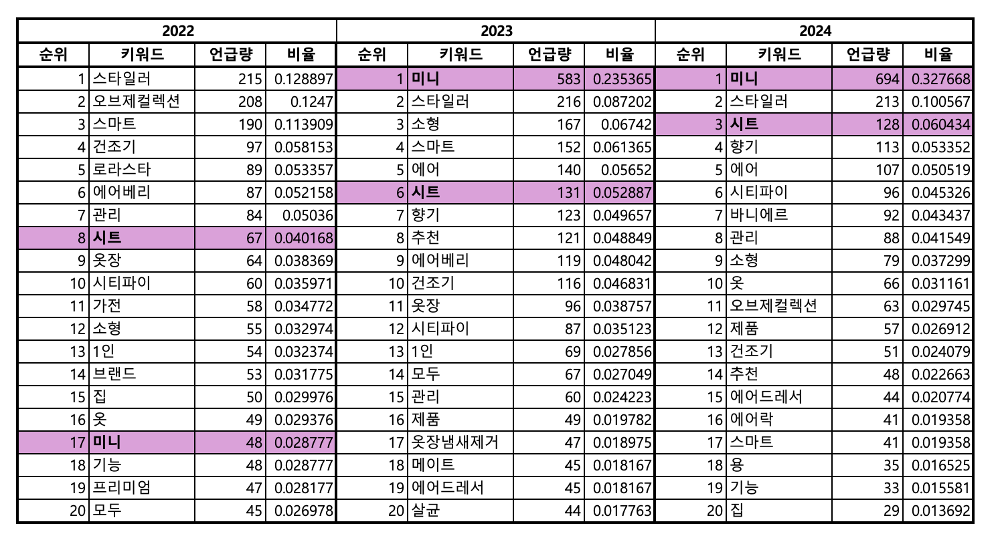
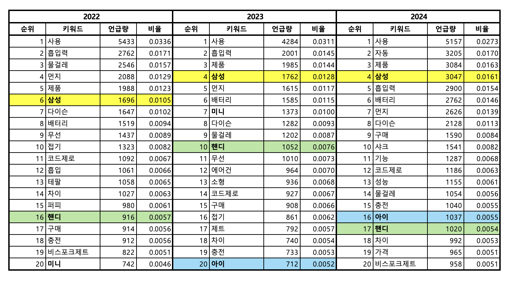
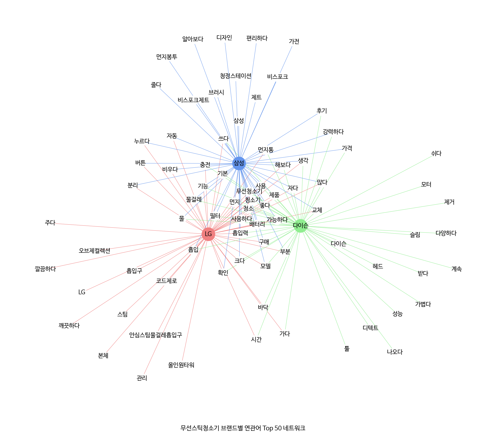

# LG전자 제품 VOC: 예상 밖의 키워드에서 사용 맥락 찾기

> 산학협력 분석의뢰 | 의류관리기·무선스틱청소기 VOC

## 프로젝트 요약

* **의류관리기 ‘미니’:** ‘미니’의 연관어와 게시글에서 작은 주거 공간·접이식 보관·여행 시 휴대 맥락.
* **무선청소기 ‘핸디’:** ‘미니·소형·원룸’ 등 연관어와 게시글에서 원룸 사용·차량 내부 청소의 경량·휴대성 맥락.
* **무선청소기 브랜드:** LG ‘관리·코드제로’, 삼성 ‘먼지봉투·브러시·디자인’, 다이슨 ‘헤드·가볍다·성능’ 등 브랜드별 특징 어휘.

## 분석 배경과 질문

생활과학 계열 연구소의 의뢰를 받아 LG전자 산학협력 과제에 참여했다. 블로그·카페 게시글과 유튜브 자막에서 의류관리기·무선스틱청소기에 대한 소비자 의견을 분석해, **제품 기능과 함께 어떤 사용 맥락이 나타나는가**를 살펴보았다.

## 수행 내용과 역할

| 분석 항목 | 사용 기술·방법 | 수행 내용 |
|---|---|---|
| 자료 수집 | Selenium, YouTube Data API v3·youtube-transcript-api | 티스토리 글·유튜브 자막 수집 |
| 데이터 통합·공통 전처리 | Python, KoNLPy Okt, 불용어·노이즈 문서 필터링 | 수집 자료 통합, 공통 제외 기준 적용·텍스트 전처리 (공동) |
| 빈도 집계 | Python, 빈도 집계 | 전체·연도·계절별 빈도 집계 |
| 3개년 변화 | Python, 연도별 비교 | 3개년 변화 분석 |
| 연관어·게시글 맥락 | Python, 연관어 분석 | ‘미니’·‘핸디’ 등 연관어·게시글 맥락 분석, 연관어 분석 코드 작성 |
| 감정어 주변 어휘 | 분석 대상 감정어 목록 설정, 연관 키워드 집계 | ‘편리하다’ 등 감정어별 주변 어휘 분석 |
| 무선청소기 브랜드 | NetworkX 연관어 네트워크 | 브랜드별 결과 산출·해석 |

* **팀 구성:** 4인 분석팀
* **수행 기간:** 2024년 11월~2025년 2월

## 데이터

| 항목 | 범위 |
|---|---|
| 데이터 | 네이버 블로그·카페, 티스토리, 유튜브 자막 |
| 수집 기간 | 2022~2024년 기준 |
| 검색어: 의류관리기 | 의류관리기, 스타일러, 에어드레서, AI스타일러, AI에어드레서, LG스타일러, 삼성에어드레서 |
| 검색어: 무선스틱청소기 | 무선스틱청소기, 무선청소기, LG무선청소기, 삼성무선청소기, 다이슨 무선청소기, AI무선청소기, LG무선스틱청소기, 삼성무선스틱청소기, 다이슨무선스틱청소기 |
| 전처리 | 두 제품군에 공통 제외 기준 적용: 홍보·질문·판매 글, 300자(공백 포함) 이하 글, 중복 글 제거; 소비자 후기 중심 선별 |
| 규모 | 의류관리기 22,024건 수집 → 전처리 후 5,044건; 무선스틱청소기 24,014건 → 5,909건 |
| 연도별 결과 | 2022·2023·2024년을 각각 집계 |

## 주요 발견

### 의류관리기 ‘미니’: 작은 공간·보관·휴대성

*2022~2024년 의류관리기 연관어 상위 20위 표, 강조 칸이 ‘미니’.*

* **관측:** 의류관리기 연관어 상위 20위에서 ‘미니’ 2022년 17위, 2023·2024년 1위.
* **게시글 맥락:** ‘사이즈·접이식·휴대’ 연관어와 작은 주거 공간, 대형 제품의 크기·비용 부담, 접이식 보관, 여행 사례.
* **해석:** 대형 제품의 가격·설치 공간 부담, 보관·휴대의 어려움과 연결되는 소형 의류관리기 관심.
* **활용:** 제품의 크기·보관·휴대성 검토 단서.

### 무선청소기 ‘핸디’: 원룸과 함께 나타난 경량성

*2022~2024년 무선청소기 연관어 상위 20위 표, 강조 칸이 ‘핸디’.*

* **관측:** ‘핸디’의 무선청소기 연관어 상위 20위 3개년 연속 등장.
* **게시글 맥락:** ‘미니·소형·원룸·휴대·가볍다’ 연관어와 원룸 사용·차량 내부 청소를 위해 작고 휴대하기 쉬운 핸디형 청소기를 찾는 사례.
* **해석:** 좁은 주거 공간과 차량 내부에서 경량·휴대성에 관심을 보이는 사용 장면.
* **활용:** 원룸·차량 청소에 맞는 사용 장면과 메시지 검토 단서.

### 무선청소기 브랜드: 관리·소모품·사용감

*무선스틱청소기 LG·삼성·다이슨 브랜드별 연관어 상위 50개 네트워크 그림.*

* **관측:** 브랜드별 상위 50개 연관어 중 다른 두 브랜드에는 없고 최근 언급 비중이 늘어난 어휘는 LG ‘관리·코드제로’, 삼성 ‘먼지봉투·브러시·디자인’, 다이슨 ‘헤드·가볍다·성능’ 등.
* **게시글 맥락:**
  * LG ‘관리’의 연관어: ‘필터’ 3개년 연속 증가, ‘비우다’ 2024년 증가.
  * 삼성 ‘먼지봉투’ 주변: ‘교체’ 2024년 증가, ‘호환’ 신규 등장. 다이슨 ‘가볍다’ 주변: ‘무게·흡입력’ 3개년 연속 증가.
  * 실제 게시글: LG 제품의 버튼 하나로 먼지통을 비우는 경험, 삼성 비스포크 디자인을 추천 이유로 든 경험.
* **해석:** LG는 필터·먼지 비우기 등 관리 경험과 모델명, 삼성은 소모품·디자인, 다이슨은 무게·흡입력 중심의 사용감.
* **활용:** 상품 소개·광고 문구 후보 선정 시 브랜드별 소재 참고.

## 해석 범위와 한계

* **자료 범위:** 2022~2024년 검색어로 수집한 네이버 블로그·카페, 티스토리, 유튜브 자막과 전처리 후 남은 후기에 한정. 전체 소비자 의견의 분포로 일반화하기 어려움.
* **연도별 비교:** 언급 빈도·순위에 연도별 수집량과 검색어가 영향을 줄 수 있음. 키워드 변화의 사용 맥락은 연관어·게시글 사례로 함께 확인.

## 분석 코드

* **공개용 코드와 실행 범위:** [수집·전처리·분석 노트북 안내](code/README.md). 원자료와 당시 보고서 결과의 완전 재현은 포함하지 않음.
